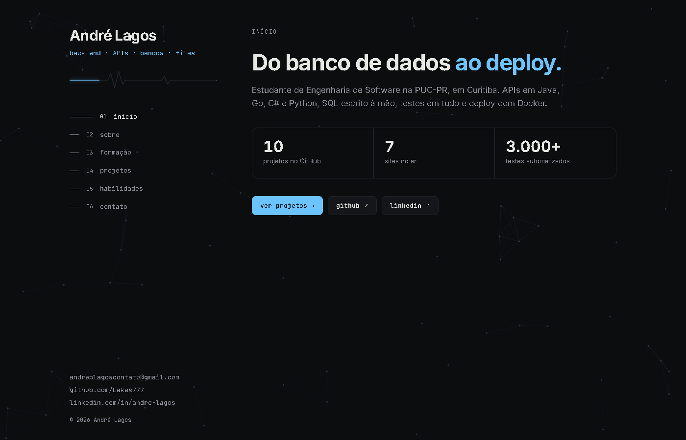
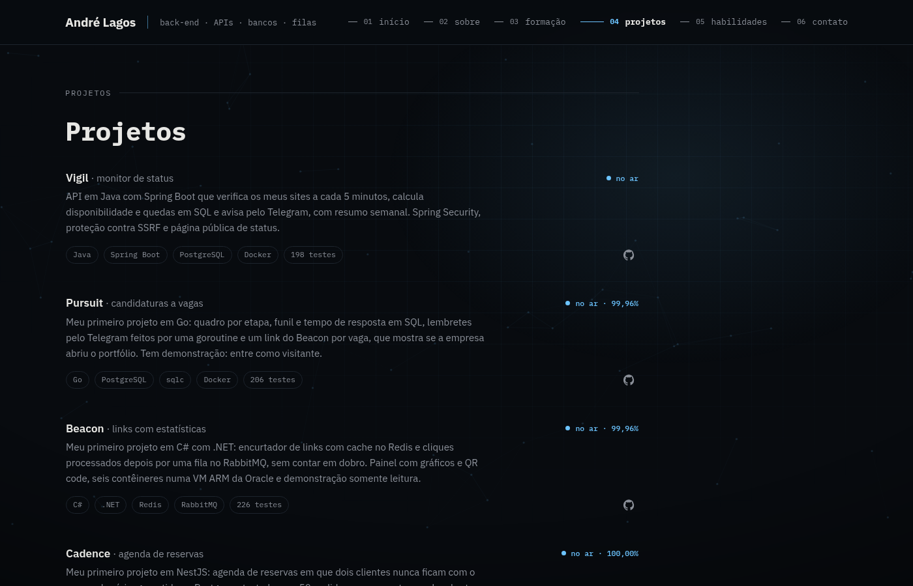

<div align="center">

# Portfólio — André Lagos

Meu site pessoal, feito do zero com **HTML, CSS e JavaScript puros** e publicado com **GitHub Pages**.

[](https://lakes777.github.io)






</div>

## Funcionalidades

- **Seções em abas**: cada seção (Início, Sobre, Formação, Projetos...) aparece sozinha, escolhida pelo
  endereço (`#projetos`), então o botão Voltar do navegador e links diretos funcionam. Sem JavaScript,
  todas aparecem uma embaixo da outra
- **Coluna fixa à esquerda** com o nome, as abas (o traço cresce na aba ativa) e o contato; no celular,
  as abas viram uma barra presa no topo que rola de lado
- **Fundo de rede**: pontos que andam devagar e se ligam quando ficam perto, como um mapa de serviços,
  desenhados num `<canvas>`; perto do mouse, acendem. A animação para quando a aba do navegador fica escondida
- **Pulso embaixo do nome**: uma linha de batimento animada, o mesmo tema do [Vigil](https://github.com/Lakes777/vigil)
- **Cards de projeto com destaque suave**: fundo, borda, sombra e uma leve subida entram juntos e devagar,
  e um brilho segue o mouse dentro do card
- **Números que contam** e blocos que entram em sequência ao abrir cada aba
- **Selo "no ar" ao vivo** nos projetos publicados: a página lê a API do Vigil (o monitor de status que
  fiz em Java) e mostra a situação e a disponibilidade em 30 dias; se o Vigil não responder, os cards só
  ficam sem o selo. O Vigil só libera a leitura para o endereço publicado, então rodando localmente o selo
  não aparece. Com o Hanami no ar, o aviso de "servidor gratuito demora para acordar" some, porque as
  visitas do Vigil a cada 5 minutos o mantêm acordado
- **Copiar e-mail** com um clique
- **Acessível**: respeita a preferência de "reduzir movimento" do sistema (aí nada se mexe: o fundo é
  desenhado uma vez, parado), tem link para pular para o conteúdo, usa HTML semântico e, ao trocar de
  aba, leva o foco para o título da seção
- **Sem frameworks nem dependências**, só três arquivos

## Estrutura

```
├── index.html      # estrutura e conteúdo do site
├── css/
│   └── style.css   # estilos (cores ficam em variáveis no topo)
├── js/
│   └── main.js     # abas, fundo de rede, contadores, selo do Vigil
└── assets/
    ├── preview.png  # aba Início (imagem deste README)
    └── projetos.png # aba Projetos (imagem deste README)
```

## Como rodar localmente

```bash
git clone https://github.com/Lakes777/Lakes777.github.io.git
cd Lakes777.github.io
```

Depois é só abrir o `index.html` no navegador. Não precisa instalar nada.

## Personalizando

As cores do site ficam em variáveis CSS no começo de `css/style.css`:

```css
:root {
  --fundo: #0c0d0f;    /* fundo */
  --cor: #6cc4ff;      /* cor de destaque */
  ...
}
```

Troque os valores e o site inteiro muda junto (a cor dos pontos do fundo fica no `main.js`).

## Créditos

Fontes [Inter](https://rsms.me/inter/) e [JetBrains Mono](https://www.jetbrains.com/lp/mono/) (licença OFL), pelo Google Fonts.

## Contato

[](https://www.linkedin.com/in/andre-lagos)
[](https://mail.google.com/mail/?view=cm&fs=1&to=andreplagoscontato@gmail.com)
